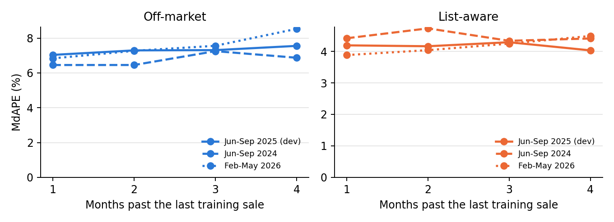

# What is this home worth, and when?

**SSU Data Dash 2026: predicting Toronto home prices.** Case: [`handout.md`](handout.md). Judging: [`rubric.md`](rubric.md). All data is synthetic.

| Track | Question | Baseline MdAPE | **Our walk-forward MdAPE** | Ours, 4 months ahead (three periods) |
|---|---|---|---|---|
| Off-market (counts double) | What is it worth, with no list price? | 20.8% (starter) | **6.96%** | 6.70% to 7.61% |
| List-aware | What will this listing close at? | 7.3% (list price) | **3.96%** | 4.17% to 4.46% |

The bar to beat is 17.7% on both tracks. **We expect about 7 to 8% and 4 to 4.5% on the hidden test.** Full table: [`reports/validation_report.md`](reports/validation_report.md).

## The story

### 1. The trap: the test is further away than it looks
The starter's validation predicts one month ahead. The hidden test is up to **four** months past the last sale we can see. Tree models cannot extrapolate: give them the date and they freeze at the last month they saw. Prices here also rise every spring and fall every autumn, and the test covers June to September.

### 2. The idea: separate *when* from *what*

```
log(price) = market level when it sells   +   what this particular home is worth
             forecast explicitly              learned by gradient-boosted trees
             (market.py: MarketIndex)         (features.py, models.py)
```

The market level is measured on comparable homes, so a month with more condos does not look like a crash. The forecast is humble: the recent level plus the season. Dropping the season costs off-market about 1.1 points of MdAPE.

### 3. The neighbours, with one strict rule
What similar homes nearby sold for is a key signal: the nearest sales, the same building, the same community. **A sale counts as a comp only if it closed strictly before this home was listed.** `tests/test_submission_model.py` plants absurd later sales and checks that nothing changes.

### 4. What the listing says
The remarks describe condition: "fully redone" versus "offered as-is". Twelve groups of phrases cut off-market MdAPE by about 0.9 points.

### 5. Two different questions
**Off-market** never touches a list price, not even past homes' sold-to-list ratios. **List-aware** predicts `log(sold / list)`, learning only the correction to the asking price.

### 6. What we refused to use
- `external_avm_estimate`: 70% of its dates are after the sale, and the test files do not have it.
- `days_on_market` and `date_sold`: known only after the sale.
- The hint that a test home listed long ago must have sold slowly: that comes from how the test file was selected.

### 7. Keeping ourselves honest
All choices were made on **one development block** (train before June 2025, test June to September 2025). The official months were only run after the design was frozen. Ideas that failed are reported too, in [`reports/experiments.md`](reports/experiments.md), including one of our own (aging the training comps). The same simple model scored 9.86% on a time-based test and a flattering 8.19% on a random split.

### 8. Where it fails
- **Expensive homes.** Over $2.5M, off-market MdAPE is 14.84% with a median undervaluation of 11.5%. Comps are scarce and the trees shrink towards typical prices.
- **Freehold homes.** Detached, semi and freehold townhouses sit at 8.5 to 9%, against 5.9% for condos.
- **Some neighbourhoods.** MdAPE runs from 3.39% to 13.01%, with biases in both directions.
- **Bidding wars.** In list-aware, homes closing over 110% of list have 12.18% MdAPE, almost all of it undervaluation.

Our 80% price ranges held the sold price 79% of the time in validation and 76 to 78% four months ahead, so they are slightly narrow. Ranges for every test home: `reports/price_ranges_*.csv`.




## Where things are

| File | Chapter | What it does |
|---|---|---|
| `features.py` | 1 | Describes a home in numbers, using only pre-sale columns |
| `market.py` | 2 | Market index, its forecast, and time-safe comps |
| `models.py` | 3 | The two models, plus the starter baselines |
| `run.py` | 4 | Commands: validation, backtests, predictions |
| `analysis.py` | 5 | Where it fails, and the calibrated price ranges |
| `experiments.py` | | Every variant we tried, on the development block |
| `tests/` | | The starter's checks and our leakage checks |
| `submissions/` | | **The two files we hand in** |
| `report/report.tex` | | The report |
| `video/talking_points.md` | | Outline and numbers for the video |

## Reproduce it

Python 3.10 or newer. The data downloads itself from [Hugging Face](https://huggingface.co/datasets/Baliyang/SSU_data_dash). On Windows, use `py` if `python` is not found.

```
pip install -r requirements.txt
pytest                     # the checks, on tiny made-up data
python run.py validate     # required walk-forward test, Dec 2025 to May 2026
python run.py report       # results table and figure
python run.py backtest     # frozen training, four months ahead, three periods
python run.py predict      # writes submissions/submission_off_market.csv and submission_list_aware.csv
python run.py analyse      # failure analysis, figures and price ranges
python run.py check        # the organisers' format check
python experiments.py      # optional: every variant we tried
```

Random seeds are fixed. Tiny floating-point differences are possible across platforms.

**Outside data:** none.
