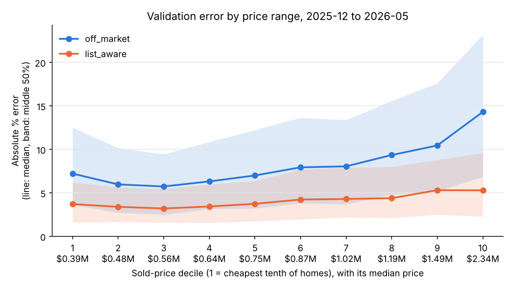
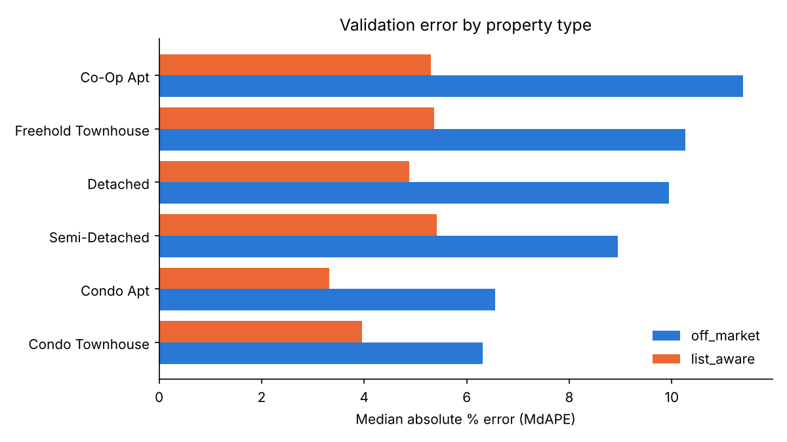
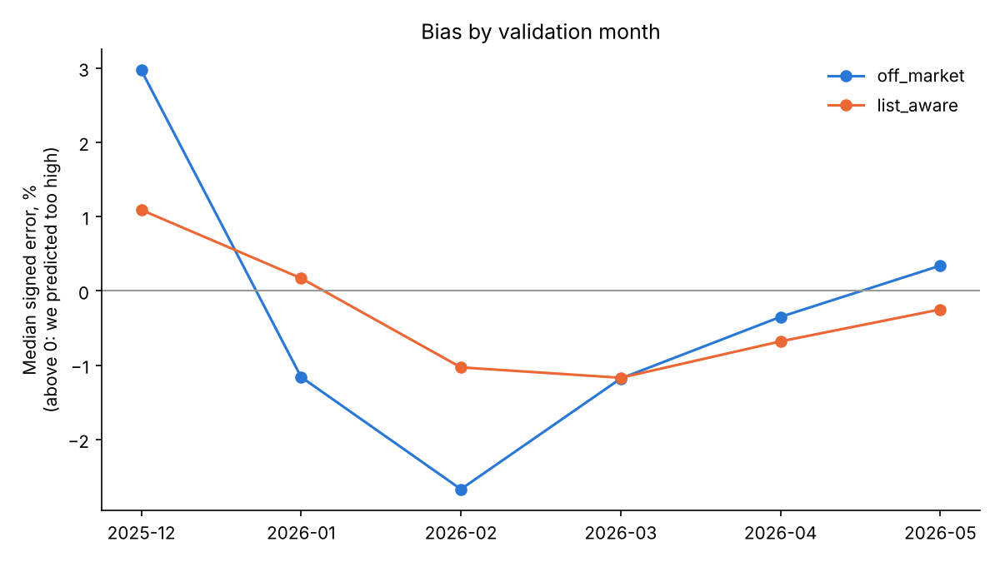

# What is this home worth *today*?

**SSU Data Dash 2026: predicting Toronto home prices** · Team YOUR TEAM NAME

> A seller in Leslieville asks: *"What's my semi worth?"* Their agent pulls the last
> ten sales nearby and takes the median. But half of those sold in the spring 2022
> frenzy, two were condos, and none was the same size. That gets you an estimate that's
> off by **one fifth**, and it's what the starter model does.
>
> We built a model that fixes each of those mistakes, one at a time. It cuts the error on
> the hard question, an off-market home with no asking price, from
> **20.8% to 7.86%**.

| Track | Question | Starter baseline (MdAPE) | **Our model (MdAPE)** | MAPE |
|---|---|---|---|---|
| Off-market (counts ×2) | What is this home worth, with no list price? | 20.8% | **7.86%** | 10.18% |
| List-aware | What will this listing close at? | 7.3% | **3.96%** | 5.11% |

*Walk-forward validation, December 2025 to May 2026: every month is predicted only from
the sales before it, the same way the hidden test works. The bar to beat ("maximum error")
is 17.7%. Full table with 95% intervals:
[`reports/validation_report.md`](reports/validation_report.md).*

---

## The story in four chapters

### 1. The problem: a price is a moment in time

Toronto prices boomed through early 2022, fell hard, and drifted through 2026. A sale from
February 2022 says very little about a home's value in June 2026 *until you adjust it for
the market*. The starter baseline doesn't adjust, so its comparable sales are stale.

**What we did.** We built a **market index** per property type and month. Location is
removed first (each sale is compared to its own neighbourhood and type), then we take the
monthly median of what's left and smooth it over three months. Every past sale is
converted to *last-month dollars*. The model learns in those dollars and prices the test
homes at the latest level. That's the only honest choice, because we can't see June to
September.

### 2. Location, done carefully

"Nearby" means a lot more than a radius. We give the model three views of location, all
measured in today's dollars:

- **Comparable sales.** The 10 nearest past sales *of the same property type*, with their
  median adjusted price, median price per sq ft, the closest three, and how far away the
  10th one is (a measure of how sure we can be).
- **Neighbourhood levels.** Each community's price per sq ft, overall and by type,
  *shrunk toward the city average* when the community has few sales, so one odd sale
  can't define a neighbourhood.
- **Raw coordinates** for the tree model to find finer patterns.

**No leakage, even in training.** A training home's own price is never part of its
features. Neighbourhood levels are computed *out-of-fold* (5 folds), and comparable sales
skip the home itself.

### 3. What the listing says

The remarks are written by the seller's agent, and they say a lot: *"fully redone"*,
*"offered as-is"*, *"for an investor looking for potential"*. We flag keyword groups
(renovated, needs work, luxury, views and ravines, pool, basement and income suites,
transit, corner lot, penthouse) and add size, rooms, parking, garage and lot features.

### 4. The list-aware track: predict the gap, not the price

When the list price is known, it already holds most of what the market knows (the starter
gets 7.3% just by copying it). So we **predict the sold-to-list ratio** instead of the
price. The model learns *when* homes go over or under asking:

- **List vs comparable sales.** A listing priced below its comps attracts bidding wars.
- **List vs neighbourhood value.**
- **Pricing strategy.** Round numbers like \$1,000,000 and "charm" prices like \$899,900.
- **Season and type.**

The off-market model **never sees the list price**. It's removed before the model is
called (`data.hide_answers`), exactly as in the off-market test file.

---

## How honest is it?

**Walk-forward, not random.** A random split lets the model peek at the future and
makes the error look smaller than it is. `python run.py validate` retrains from scratch for
each of six months, using only sales *before* that month.

**We did not use the third-party estimate** (`external_avm_estimate`). It isn't in
the test files, and many of its dates fall *after* the sale. A model that leans on it
couldn't be used in real life.

**Uncertainty, not just a number.** Two extra models predict the 10th and 90th percentile
of the price, which gives an 80% range for every home:

| Track | Sold price inside our 80% range | Typical range width |
|---|---|---|
| Off-market | 73.9% | ±14% (a little narrow: widen ~10% before relying on it) |
| List-aware | 78.9% | ±8% |

The test-set ranges are in `outputs/test_ranges_*.csv` after `python run.py predict`.

**One run, not the best of many.** The numbers above come from a single validation run of
the final model. We didn't tune on the validation months, so the hidden test should land
close to them. The hidden test runs 1 to 4 months past the last training sale, while
validation is only ever 1 month ahead, so expect slightly larger errors if the market moves
over the summer.

---

## Where it fails

`python run.py analysis` writes [`reports/error_analysis.md`](reports/error_analysis.md) and
these figures:

| | |
|---|---|
|  |  |

**What the errors tell us**

- **Condos are easiest** (off-market 6.6% MdAPE). Units in one building share a location and
  comparable sales. **Detached homes (9.9%), freehold townhouses (10.3%) and co-ops (11.4%,
  only 48 homes) are hardest.** For freehold homes, lot, layout and condition vary far more
  than any listing field captures.
- **The worst neighbourhoods are *consistently* under-predicted.** In Hazelfield (15.6% MdAPE)
  the median signed error is −11%, and Maplepark, Sycamoredale and Birchgrove are similar.
  These areas appear to be rising faster than the city-wide index for their type. A
  community-level index is our next step.
- **Extremes are hard.** The cheapest and dearest tenth of homes have fewer comparables, and
  the model pulls them toward typical prices.
- **Monthly swings are market noise.** Off-market bias moves between −2.7% and +3.0% from
  month to month, but MdAPE stays between 7.4% and 8.0%. That steadiness is why we expect the
  hidden test to land near our validation number.
- **One fix, made after looking.** Our first list-aware model predicted **2.4% too high in
  every month**. It had learned 2022's bidding-war sold-to-list ratios. Adding a *ratio index*
  (chapter 4) brought the bias to −0.4% and MdAPE from 4.53% to 3.96%. This was the only change
  we made after seeing validation results.

**When not to trust it:** co-ops, the top and bottom price tenths, communities with few
recent sales, and any month where the market turns sharply.



---

## Run it yourself

Python 3.10+. The data downloads itself from
[Hugging Face](https://huggingface.co/datasets/Baliyang/SSU_data_dash) on first use.

```bash
pip install -r requirements.txt
python run.py validate    # walk-forward test, Dec 2025 to May 2026 (~10 min)
python run.py report      # results table, 80% range coverage, figure
python run.py analysis    # errors by type, month, neighbourhood
python run.py predict     # write both submission files (+ 80% ranges)
python run.py check       # check them
pytest                    # leakage and pipeline tests
```

Optional: `python run.py baselines` reruns the two starter baselines for a side-by-side
table (slow: the nearest-sales baseline loops over every home).

Already have the files? `DATA_DIR=path/to/folder python run.py validate`.

## What's where

| File | What it does |
|---|---|
| [`features.py`](features.py) | `FeatureBuilder`: market index, neighbourhood levels, comparable sales, text flags. Learns only from the training sales. |
| [`models.py`](models.py) | `OffMarketModel` (log price in today's dollars) and `ListAwareModel` (log sold-to-list ratio), gradient-boosted trees with 80% ranges. Starter baselines kept for comparison. |
| [`run.py`](run.py) | `validate`, `report`, `analysis`, `predict`, `check`, `baselines`. |
| [`submissions/`](submissions) | The two files we hand in. |
| [`report/report.tex`](report/report.tex) | Our 4-page report. |
| [`handout.md`](handout.md), [`rubric.md`](rubric.md) | The case, from the organisers. |

## Rules we followed

- **No outside data.** Everything comes from the provided synthetic files.
- **No list price in the off-market model**, and nothing known only after the sale (sold
  price, sale date, days on market, third-party estimate) is used as a feature.
- Every number here comes from our own walk-forward validation.

*All data is synthetic. Built on the organisers'
[starter repository](https://github.com/erwinzhang7/SSU-Data-Dash).*
