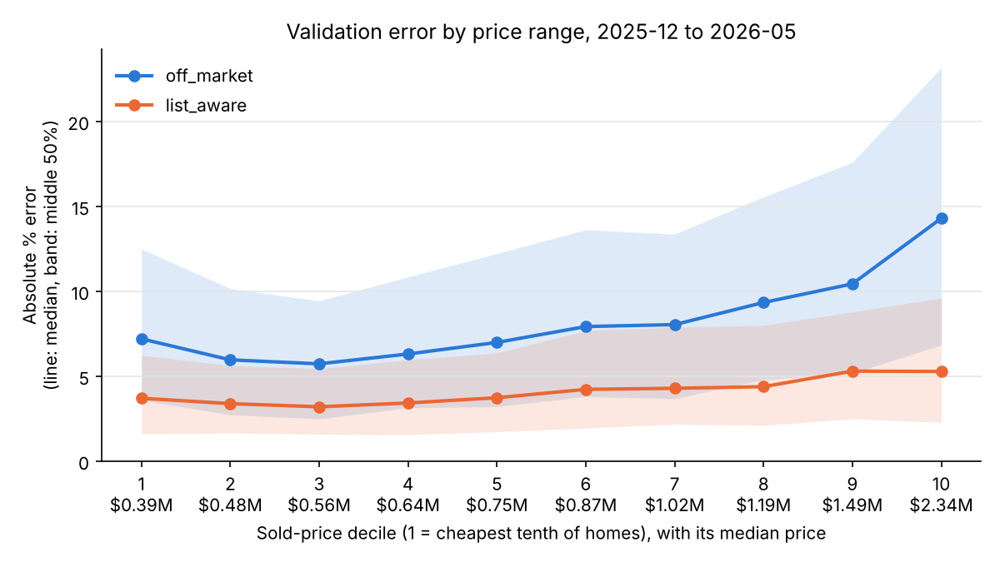

# Validation report

Walk-forward validation, 2025-12 to 2026-05: each month was predicted by models trained only on the sales before it.
Errors are (predicted - sold) / sold. Brackets: bootstrap 95% interval.

| Track | Homes | MAPE | MdAPE | Median signed error |
|---|---|---|---|---|
| off_market | 10,069 | 10.18% (9.98 to 10.37) | 7.86% (7.67 to 8.05) | -0.35% |
| list_aware | 10,069 | 5.11% (5.02 to 5.19) | 3.96% (3.88 to 4.07) | -0.42% |

80% price ranges (10th to 90th percentile models): a good range holds the sold price 80% of the time.

| Track | Sold price inside the range | Median range width |
|---|---|---|
| off_market | 73.9% | 28.4% of the price |
| list_aware | 78.9% | 15.3% of the price |

MAPE: mean absolute percentage error. MdAPE: median absolute percentage error.
A median signed error above 0 means the model tends to predict too high.
The intervals treat homes as independent. Homes sold in the same month share the same
market swings, so the real uncertainty is somewhat wider.

